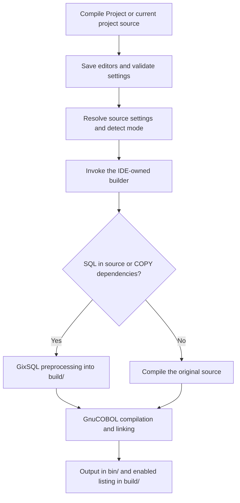

# OpenCobolIDE modern11.6 — How to

Date: 26 October 2026. This guide describes the consolidated modern11.6 build, including the copybook creation and safe project lifecycle improvements. Historical `+projectN` names identify development iterations only.

For installation of this exact build, use the package and replacement commands in README.md. The build's verification report records the final test results. Mageia 10 and Fedora 44 native RPM testing is performed separately on their persistent USB installations before release uploads.

## Contents

1. [Overview](#1-overview)
2. [New Project](#2-new-project)
3. [Open Project and source discovery](#3-open-project-and-source-discovery)
4. [Configure Project](#4-configure-project)
5. [Project and source settings](#5-project-and-source-settings)
6. [Portable configuration format](#6-portable-configuration-format)
7. [Settings inheritance](#7-settings-inheritance)
8. [Internal project builder](#8-internal-project-builder)
9. [Automatic executable/module detection](#9-automatic-executablemodule-detection)
10. [GixSQL integration](#10-gixsql-integration)
11. [Listings, cross references and symbols](#11-listings-cross-references-and-symbols)
12. [Validation and conflict handling](#12-validation-and-conflict-handling)
13. [Migration and project portability](#13-migration-and-project-portability)
14. [Minimal project walkthrough](#14-minimal-project-walkthrough)
15. [Verification and Debian package](#15-verification-and-debian-package)
16. [Troubleshooting](#16-troubleshooting)
17. [Implementation map and current scope](#17-implementation-map-and-current-scope)

## 1. Overview

OpenCobolIDE now has a project workflow in addition to its existing individual-file workflow.

A user can create or open a project, review its sources, set shared compiler defaults, supply source-specific overrides, validate the combined settings, and compile the project using a builder installed with the IDE.

The main additions are:

| Feature | Result |
| --- | --- |
| New Project | Creates a standard folder structure and initial project configuration. |
| Open Project | Opens recognized COBOL sources and keeps the file tree at the project root. |
| Configure Project | Shows source inheritance/overrides and validation results. |
| Portable configuration | Saves project defaults and source overrides in `config/project.json`. |
| Compile Project | Compiles discovered sources in one background batch. |
| Internal builder | Uses the IDE-owned script instead of a project-folder `build.sh`. |
| Automatic mode | Selects `-x` or `-m` per source. |
| GixSQL detection | Preprocesses sources that contain SQL, including SQL found through COPY dependencies. |
| Listings | Generates separate source listings with cross-reference and symbol information. |
| Validation | Detects known settings, path and artifact conflicts before compilation. |

The **modern** name and version scheme are retained.

## 2. New Project

### Where to find it

Use either:

- **File → New Project…**
- **New Project** on the opening screen.

The dialog asks for a project name and an existing parent folder. A Browse button selects that folder.

For a project named `MyProject`, the IDE creates:

```text
MyProject/
├── src/
├── copybooks/
├── bin/
├── build/
├── data/
└── config/
    └── project.json
```

| Folder | Intended use |
| --- | --- |
| `src` | COBOL program and module source files. |
| `copybooks` | Shared COPY definitions. |
| `bin` | Executables and loadable modules produced by the internal builder. |
| `build` | Listings and generated SQL-preprocessed COBOL. |
| `data` | Application data files chosen by the project author. |
| `config` | IDE project configuration and any separate application/runtime configuration. |

The `data` folder is a scaffold: the IDE does not create databases or application-specific data formats, or automatically change the program's runtime working directory to this folder.

### Existing-file protection

Project creation checks the folder destinations before creating them.

- Existing folder contents are preserved.
- An existing valid `config/project.json` is retained.
- An existing file occupying a required directory name, such as `src` or `data`, is reported as a conflict.
- Invalid existing configuration is reported rather than replaced.
- Empty names, `.`/`..`, path separators and control characters are rejected in project names.

After creation, the project opens and the Configure Project window is offered. No starter COBOL source is created automatically.

### Adding sources

When a project is active, the existing New File workflow defaults to `src` when that folder exists. After a new file is opened, the IDE offers to configure source-specific compiler settings.

Choosing **No** keeps the inherited settings. Choosing **Yes** opens the source settings dialog.

### Creating a copybook

New File includes `.cpy` and `.CPY` even though those extensions are not compiler targets. Selecting one chooses the Empty template, avoiding a PROGRAM-ID or PROCEDURE DIVISION stub. In a project, an unchanged default src/root directory switches to copybooks/. A custom directory choice is preserved. Switching back to a source extension restores the previous source template and automatic directory choice.

Copybooks open in the COBOL editor. Their standalone Compile/Run and program-type controls are disabled, while Compile Project remains available. There is no standalone compiler-settings prompt for a new copybook. Programs use copybooks through COPY statements.

## 3. Open Project and source discovery

Use **File → Open Project…** or the opening-screen **Open Project** button and select the project directory.

The IDE then:

1. Loads `config/project.json`, or creates it by importing older saved project/source preferences when the file is absent.
2. Remembers the project root.
3. Displays the project file tree.
4. Opens recognized compilable COBOL source files, including sources in subfolders.
5. Offers Configure Project.

An existing project layout is accepted. Opening it does not move existing source files into `src`.

### Discovery rules

Discovery uses the configured compiler source extensions and a deterministic sorted recursive traversal.

It excludes:

- Generated `bin` and `build` directories.
- Hidden directory entries.
- `__pycache__` and `venv` directories.
- Hidden files and file symlinks.
- Standalone copybooks and generated/listing suffixes such as `.cpy`, `.lst`, `.prn` and `.cbsql`.

Copybooks remain accessible in the tree but are not compiled as independent project sources.

The project tree remains rooted at the selected project when the active editor changes.

### Invalid configuration

If the configuration cannot be read or its supported schema is invalid, the IDE reports the error. It does not silently replace the file or switch away from the current project.

### Closing and switching projects

Use **File → Close Project**. It closes the active project's documents, including split/detached views, and its Configure Project window. It clears the tree/lock, active project and old build messages. Project files, saved configuration, binaries and listings are not deleted. Unrelated standalone tabs stay open.

Opening another project closes the previous project's documents first. Save/Discard/Cancel handles unsaved project files. Cancel, canceled Save As and failed saves preserve the old project context. An invalid target configuration is reported before closing the old project. Reopening the same project keeps existing editors and unsaved changes.

Close/switch is blocked during compilation, a pending Run request or an embedded program. Stop the operation first. Closing the last source tab alone leaves the project active and its menus accessible.

## 4. Configure Project

Use **File → Configure Project…** to reopen this screen at any time.

The source table shows:

| Column | Meaning |
| --- | --- |
| Source | Project-relative source path, such as `src/worker.cbl`. |
| Compiler settings | Whether the source inherits project defaults or has source overrides. |
| Validation | The source's current OK, Warning or Error status. |

Available actions are:

- **Project defaults…** — edit shared settings.
- **Selected source settings…** — edit the selected source without needing to change editor tabs first.
- **Validate settings** — refresh the checks and report.
- **Close** — return to editing.

The report area identifies the affected source and the reason for each diagnostic. Sources with no meaningful override are displayed as inheriting project defaults, including after a reset.

## 5. Project and source settings

### Menu locations

| Action | Location |
| --- | --- |
| Shared project settings | **COBOL → Project compiler settings…**, below Compile Project. |
| Current source settings | **COBOL → Compiler options for this file…** |
| Review all sources | **File → Configure Project…** |

### Supported fields

| Setting | Purpose |
| --- | --- |
| Extra compiler flags | Ordered compiler arguments; an explicit list replaces inherited extra flags. |
| Compiler path | Selects `cobc`, or an alternative compiler command/path. |
| Additional tools directory | Adds a tools directory before the inherited `PATH`. |
| `COB_COPY_DIR` | Supplies an inherited compiler copybook environment path. |
| GixSQL preprocessor | Selects the `gixpp` command or path. |
| GixSQL copybook directory | Selects the GixSQL include directory. |
| GixSQL library directory | Selects the GixSQL link-library directory. |
| Copybook paths | Project-relative or absolute include directories. |
| Library paths | Project-relative or absolute library search directories. |
| Libraries | Library names passed to the compiler/linker. |
| Source format | Inherit, Fixed or Free. |
| Listing | Inherit, Generate listing or No listing. |
| Listing filename | A fixed path or a pattern containing `{stem}`. |

Path-list fields in the dialog use semicolons between entries. Library names and extra flags use shell-style quoting, so operands containing spaces can be entered without being split incorrectly.

Executable/module selection is not a project-configuration field: `-x` and `-m` remain automatically selected per source.

### Reset and inheritance controls

- The flags checkbox selects inherited flags instead of a source/project-specific list.
- Each path/library list has an Inherit control.
- Blank environment fields inherit the corresponding setting from the level above.
- Reset clears the source-specific controls back toward inheritance.
- **Use these project settings** enables/disables project defaults. Explicit source overrides remain available when project defaults are disabled.

## 6. Portable configuration format

### File location

```text
<project-root>/config/project.json
```

This file contains project-wide defaults and source overrides. It belongs with the project and can be kept in the project's own version control.

### Complete example

```json
{
  "schema_version": 1,
  "name": "MyProject",
  "defaults": {
    "enabled": true,
    "flags": ["-Wall", "-debug"],
    "environment": {
      "compiler_path": "",
      "path_mode": "inherit",
      "path": "",
      "cob_copy_dir": "",
      "gixpp_path": "",
      "gixsql_copy_dir": "",
      "gixsql_library_dir": ""
    },
    "copybook_paths": ["copybooks"],
    "library_paths": [],
    "libraries": [],
    "source_format": "inherit",
    "listing": {
      "enabled": true,
      "filename": "build/{stem}.lst"
    }
  },
  "sources": {
    "src/hello.cbl": {},
    "src/worker.cbl": {
      "flags": ["-Wall"],
      "environment": {},
      "copybook_paths": null,
      "library_paths": null,
      "libraries": null,
      "source_format": "inherit",
      "listing": {
        "filename": "build/worker-{stem}.lst"
      }
    }
  }
}
```

The source keys in this example assume those files have been created. A saved entry referring to a missing source produces a warning.

### Top-level fields

| Field | Meaning |
| --- | --- |
| `schema_version` | Supported configuration schema, currently `1`. |
| `name` | Project display/metadata name. |
| `defaults` | Shared compiler/build settings. |
| `sources` | Map of relative source paths to override objects. |

Source keys use forward slashes, for example `src/subfolder/worker.cbl`. Absolute source keys and parent-directory traversal using `..` are rejected.

### `null`, empty lists and blank fields

These distinctions matter:

| Value | Meaning |
| --- | --- |
| `"flags": null` | Inherit the extra flag list. |
| `"flags": []` | Supply no extra flags at this level. |
| `"copybook_paths": null` | Inherit the configured copybook list. |
| `"copybook_paths": []` | Supply no entries for that configurable list. |
| `"environment": {}` | No environment overrides at this level. |
| `"source_format": "inherit"` | Use the inherited source-format selection. |
| `"listing": {}` | Inherit the listing settings. |
| `"listing": {"enabled": false}` | Disable listing generation for this source/project level. |

An empty extra-flag list does not remove IDE-managed mode/output arguments. The internal builder also manages its standard listing, cross-reference, symbol and diagnostic options when listings are enabled. Clearing a configurable copybook list does not necessarily remove the builder's standard project/GixSQL include directories.

### Path handling

Paths inside the project are stored relative to its root when saved through the IDE. At build time they are resolved against the current root, not against an arbitrary working directory or the source's subdirectory.

For example:

```json
{
  "copybook_paths": ["copybooks", "shared/copybooks"],
  "listing": {"filename": "build/{stem}.lst"}
}
```

A source key such as `src/worker.cbl` continues to identify the same source after the project is moved to a different parent directory.

System installations may still use absolute paths, such as `/opt/gnucobol/bin/cobc`. Those paths must exist on the destination machine. A bare compiler command such as `cobc` is resolved through the effective tools `PATH`.

The configuration supports `path_mode` values `inherit`, `prepend` and `replace`. The normal dialog's additional-tools field uses prepend behavior; `replace` can be represented in the configuration file.

### Safe writes

The IDE validates the configuration structure, writes a temporary file in the configuration directory, flushes it, and atomically replaces `project.json`. A failed replacement leaves the previous document intact.

## 7. Settings inheritance

The effective settings follow:

```text
Source override
      ↓ otherwise
Project default
      ↓ otherwise
IDE default
```

An explicit source flag list replaces the project flag list; it is not appended to it. Path/library lists follow the same override/inherit distinction.

Environment settings merge by field: for example, a source can choose a different compiler while continuing to inherit the project's copybook environment directory.

Listing fields also inherit individually. A source can change the listing filename while retaining the project's enabled/disabled choice, or disable its own listing while the project continues generating listings for other sources.

The same resolved settings are used in compiler-command generation, process environment setup, the internal project builder and syntax checking where applicable. Listing-only options are removed from syntax-check commands so cross-reference settings do not cause “requires a listing file” errors during background checking.

## 8. Internal project builder

### Location and selection

The builder and SQL detector are installed inside the IDE's Python package:

```text
open_cobol_ide/build_tools/build.sh
open_cobol_ide/build_tools/detect_sql.py
```

In the Debian package, this package normally lives below:

```text
/usr/lib/python3/dist-packages/open_cobol_ide/
```

Project compilation selects these installed resources. A `build.sh` in the project root or a source subdirectory is not selected or executed.

The optional script under the documentation/examples directory is retained for command-line use. It is not the builder chosen by the IDE's project workflow.

### Build flow



### IDE-to-builder interface

These are implementation details; users normally configure the dialogs instead of setting these variables manually.

| Variable | Role |
| --- | --- |
| `OCIDE_PROJECT_DIR` | Absolute project root. |
| `OCIDE_COMPILE_MODE` | Automatically detected `-x` or `-m`. |
| `OCIDE_OUTPUT_EXTENSION` | Output extension appropriate to the selected type/platform. |
| `OCIDE_COMPILER_FLAGS` | JSON array of ordered compiler arguments. |
| `OCIDE_SOURCE_FORMAT` | Initial fixed/free format passed to SQL detection. |
| `OCIDE_GENERATE_LISTING` | Whether to generate a listing. |
| `COBC` | Effective compiler command/path. |
| `GIXPP` | Effective GixSQL preprocessor. |
| `GIXSQL_COPY_DIR` | Effective GixSQL copybook directory. |
| `GIXSQL_LIBRARY_DIR` | Effective GixSQL library directory. |
| `COB_COPY_DIR` | Effective compiler copybook environment path. |

The source's absolute filename is passed as an argument. The process runs with the project root as its working directory. Artifacts are written into the project, not into the IDE installation.

### Batch compilation and F8

**Compile Project** compiles discovered sources in deterministic order. Each selected source is compiled once in the batch; an individual failure is reported and does not prevent the thread from attempting later sources.

Settings validation occurs before the batch starts. A validation error prevents the compilation thread from starting.

**F8** retains current-source compilation and its existing dependency-autodetection behavior when enabled. A source belonging to a project uses the internal project builder. Ordinary files outside recognized projects retain the normal single-file compiler path.

The internal script handles `.cbl`, `.cob` and `.pco` project sources. Existing DBPRE/esqlOC extensions retain their dedicated compiler dispatch paths.

Compile Project is batch compilation; it does not introduce a make-style dependency graph, dependency-based build ordering or a new multi-source linker-target system.

## 9. Automatic executable/module detection

The IDE detects the mode separately for every source:

- `PROCEDURE DIVISION USING` selects module mode, `-m`.
- Other sources use executable mode, `-x`, subject to existing explicitly saved legacy file-type selections.

The detector handles a USING header split across lines. It excludes comments and quoted literals, and accounts for fixed/free source format. It no longer requires an inline `LINKAGE SECTION`, because linkage declarations may be provided through COPY files.

A Linux module normally produces:

```text
bin/worker.so
```

A Linux executable normally produces:

```text
bin/hello
```

The portable configuration has no manual executable/module field. Entering `-x` or `-m` in its extra flags is rejected with an explanation that mode is automatically detected.

## 10. GixSQL integration

The installed detector examines source text and recursively inspects COPY dependencies. It distinguishes SQL statements from text in comments and quoted literals and guards against recursive COPY traversal.

### Plain COBOL

A source without SQL is compiled directly. It does not require the GixSQL preprocessor simply because it belongs to a project.

### SQL COBOL

A source with SQL is processed with `gixpp` first. Its generated COBOL is written under:

```text
build/<source-stem>.cbsql
```

The detected executable/module mode is retained when compiling that generated source. The SQL path adds the GixSQL library-directory and link-library arguments.

SQL/COPY discovery includes configured include paths, the project copybook directory, the GixSQL copybook directory, and applicable `COB_COPY_DIR` entries.

GixSQL must be installed separately when required. The settings dialogs can select a different preprocessor or copy/library directories. Connection profiles and credentials remain application/runtime configuration; the IDE does not create a database connection merely by building a program.

The original COBOL source is not rewritten by the preprocessing workflow.

## 11. Listings, cross references and symbols

### Default output

A newly created project's default is:

```text
build/<source-stem>.lst
```

For `src/worker.cbl`, this becomes:

```text
build/worker.lst
```

The filename pattern uses `{stem}` to insert the source basename without its extension. This gives different sources separate listings.

### Cross-reference spelling

```text
--Xref -ftsymbols
```

### Custom filenames

Set a listing filename in the dialog, for example:

```text
build/{stem}.lst
build/debug-{stem}.prn
```

Explicit `-T` or `-t` filenames in extra flags are also supported. A bare `-T`/`-t` is normalized by the IDE with a generated filename. Ordered operands and filenames containing spaces are preserved.

An explicit source listing filename can replace an inherited listing operand when the source otherwise inherits its flags. An explicit listing operand in the source's own flag list remains an explicit source-level naming choice.

Relative listing paths are resolved against the project root. The final `Listing:` line in compiler output identifies the selected path. Custom nested listing directories must exist; the builder creates the standard `build` directory as needed.

### Full compile output

The compiler-output pane includes:

1. The source and selected mode.
2. The SQL detection result.
3. The exact GixSQL preprocessing command when SQL is present.
4. The exact compiler command.
5. GnuCOBOL's verbose preprocessing, parsing, translation, native compilation and linking steps.
6. The output filename and enabled listing filename.

Disabling listing generation does not delete a listing left by an earlier build. Check the compiler command and file timestamp when distinguishing old output from a fresh listing.

A source can disable its listing explicitly. Listing and cross-reference-only options are then omitted from its compile arguments, and the script does not claim that it generated a listing.

## 12. Validation and conflict handling

Validation runs when Configure Project refreshes, before changed settings are accepted, and before project-source compilation.

### Checks

| Area | Examples of reported problems |
| --- | --- |
| Configuration | Invalid JSON, unsupported schema or incorrect value types. |
| Source keys | Absolute source paths or `..` escaping the project. |
| Compiler | Missing or non-executable compiler. |
| Tools | Missing configured tools directories. |
| Includes/libraries | Missing copybook, library-search or configured GixSQL directories. |
| Required operands | Missing operands for `-I`, `-L` or `-l`. |
| Managed build options | Manual `-x`, `-m` or `-o`. |
| Incomplete build modes | Options such as `-E`, `-C`, `-S`, `-c` or `-fsyntax-only` in project build flags. |
| Source format | Both fixed/free selected, or settings conflicting with the source FORMAT directive. |
| Listings | Multiple incompatible listing destinations, unsupported placeholders, or a missing custom directory. |
| Artifact collisions | Sources producing the same output, listing or SQL intermediate path. |
| Input protection | A listing destination that would overwrite a source/configuration input or build artifact. |
| SQL dependencies | Uninspectable COPY dependencies or a required GixSQL preprocessor that cannot be found. |
| Stale source settings | Saved overrides referring to a source that is missing. |

Two source files in different subfolders can still have the same basename. The builder's current `bin` and `build` naming convention makes this important: validation reports conflicting destinations rather than silently overwriting one source's result.

### Errors and warnings

- **Errors block compilation.** The user must correct them before the compilation thread starts.
- **New errors introduced by a settings edit are rejected.**
- **Existing conflicts can be repaired incrementally.** An edit that does not introduce a new conflict can preserve an existing issue after warning, allowing separate source settings to be fixed one at a time. Compilation remains blocked until the errors are resolved.
- **Warnings require acknowledgment**, for example when configuration still refers to a source that has been removed.

The current input-protection check covers discovered source files, `config/project.json`, and lowercase `.cpy` copybooks found in the project.

The validator checks known structural conflicts and availability/path problems. GnuCOBOL remains the authority for dialect-specific option semantics, source-code errors and actual linker errors.

## 13. Migration and project portability

### Opening an older project

When `config/project.json` is absent, Open Project imports applicable older project defaults and existing source overrides from IDE preferences.

Project-internal absolute paths are converted to relative paths where supported. Existing explicitly saved listing arguments and source settings are retained. IDE-global preferences continue to act as the final fallback.

An existing `project.json` is treated as the saved configuration instead of being regenerated. The original IDE preference records are not deleted by this migration.

Opening an older project does not copy an IDE build script into it. Its existing project-folder `build.sh` may remain for manual use but is ignored by the IDE's project builder.

### Moving or sharing the project

Copy the project directory, including `config/project.json`, sources and copybooks. Relative source keys and project-local paths continue to resolve under the new root.

The destination still needs the selected compiler and any required external GixSQL installation/libraries. Absolute system installation paths may need adjustment in the settings dialog.

This is configuration portability within the supported environment, not a guarantee that platform-specific libraries or toolchains are interchangeable.

## 14. Minimal project walkthrough

### Create the project

1. Choose **File → New Project…**.
2. Enter `MyProject` and select its parent directory.
3. Confirm creation.
4. Review the project defaults in Configure Project.

### Add an executable source

Create `src/hello.cbl` with fixed-format COBOL such as:

```cobol
       IDENTIFICATION DIVISION.
       PROGRAM-ID. HELLO.
       PROCEDURE DIVISION.
           DISPLAY 'Hello from OpenCobolIDE'.
           STOP RUN.
```

Keep inherited settings unless this file needs an override.

### Add a callable module

Create `src/worker.cbl`:

```cobol
       IDENTIFICATION DIVISION.
       PROGRAM-ID. WORKER.
       DATA DIVISION.
       LINKAGE SECTION.
       01  LK-VALUE PIC X(20).
       PROCEDURE DIVISION USING LK-VALUE.
           MOVE 'Updated by WORKER' TO LK-VALUE
           GOBACK.
```

Do not add `-m` manually. The USING clause is detected by the IDE.

### Validate and compile

1. Open **File → Configure Project…**.
2. Choose **Validate settings**.
3. Correct any errors; acknowledge warnings only after reviewing them.
4. Choose **COBOL → Compile Project**.

Expected Linux artifacts are:

```text
bin/hello
bin/worker.so
build/hello.lst
build/worker.lst
```

Check the compiler-output pane for selected modes and commands. Open each listing and locate the variable/label reference sections and symbol information.

This example demonstrates separate executable/module compilation. Calling the module from an application may also require the application's normal runtime module-search configuration.

## 15. Verification and Debian package

### Verification

The regression set includes project creation and preservation, legacy migration, project moves, inheritance/reset, malformed configuration, atomic saves, conflicts, precompile blocking, safe close/switch and failed-save behavior, split/detached editor cleanup, copybook creation, real executable/module builds, default/custom/disabled listings, syntax checking, F8/run, arguments, help and source-installation checks. The consolidated release report records the final count and package-level checks.

The included examples/project-demo directory provides a writable-copy demonstration using test01.cbl, worker.cbl and a shared copybook. See its README. Source-format settings are fixed explicitly and worker has an extra-flag override so the example also demonstrates inheritance.

### Package installation

The consolidated Debian package is opencobolide_4.7.6+modern11.6_all.deb. Close the IDE before installing. To replace either a development package or an earlier plain modern11.6 build:

```bash
sudo apt install --reinstall --allow-downgrades ./opencobolide_4.7.6+modern11.6_all.deb
```

The apparent downgrade is Debian version ordering after removing +projectN. The consolidated code contains the later features. Check the published checksum when the same plain filename existed previously.

### Native RPM testing

Mageia 10 and Fedora 44 use distinct native build setups. Boot the corresponding persistent USB, build and install/test there, and retain the binary RPM, source RPM, spec, logs, environment details and checksums. Then return to Mint to assemble the final release. See packaging/RPM_MODERN11.6.md in the source distribution or RPM kit instructions.

## 16. Troubleshooting

| Symptom | What to check |
| --- | --- |
| No sources appear | Check selected source extensions and whether files are under an excluded/generated directory. |
| Compiler cannot be found | Check the compiler field and effective tools PATH; a configured path must be executable. |
| COPY file cannot be inspected | Check copybook paths, `COB_COPY_DIR`, relative path spelling and the COPY filename. |
| GixSQL is missing | Set/install `gixpp` for SQL sources; plain sources do not need SQL preprocessing. |
| Executable requested for a USING source | Remove manual `-x`/`-m` from flags; inspect source format and any legacy file-type selection. |
| No listing is visible | Check whether listing generation is disabled and read the final `Listing:` output line. |
| An old `.lst` file is unchanged | A custom setting may select a different path, such as a project-root `.prn`; inspect the actual compiler command. |
| No cross-reference section | Confirm the enabled listing was rebuilt by the internal builder and look for `--Xref` in the command. |
| `-Xrefr` rejected | Use supported `--Xref` or `-X`. |
| Two sources conflict | Compare their basenames and their resolved output/listing destinations. |
| A custom listing directory is missing | Create it or use the standard `build/{stem}.lst` location. |
| A configuration source is missing | Correct its relative source key or remove obsolete source-specific settings from the JSON. |
| Moved project fails on another machine | Check absolute external tool/library paths and installed dependencies. |
| A project `build.sh` change has no effect | Project-local scripts are intentionally ignored by the internal IDE workflow. |
| Invalid JSON prevents opening | Correct the reported file; the IDE preserves it rather than recreating it. |

## 17. Implementation map and current scope

### Main source files

| File or group | Responsibility |
| --- | --- |
| `open_cobol_ide/project.py` | Sorted recursive source discovery and exclusions. |
| `open_cobol_ide/project_config.py` | Schema, safe creation, loading, atomic saving and portable path handling. |
| `open_cobol_ide/project_validation.py` | Merged-settings checks and destination collisions. |
| `open_cobol_ide/settings.py` | Preference migration, JSON-backed settings and inheritance. |
| `open_cobol_ide/controllers/file.py` | New/Open/Configure Project and new-source setup. |
| `open_cobol_ide/controllers/home.py` | Opening-screen project actions. |
| `open_cobol_ide/controllers/edit.py` | Project tree behavior and source creation integration. |
| `open_cobol_ide/controllers/cobol.py` | Settings dialogs, precompile validation and batch compilation. |
| `open_cobol_ide/view/dialogs/project_setup.py` | New Project and Configure Project dialogs. |
| `open_cobol_ide/view/dialogs/source_compiler_options.py` | Project/source compiler controls. |
| `forms/ide.ui`, `open_cobol_ide/view/forms/ide_ui.py` | Designer and generated opening-screen widgets. |
| `open_cobol_ide/compilers.py` | Mode detection, command construction and builder invocation. |
| `open_cobol_ide/compiler_options.py` | Ordered listing options and syntax-check filtering. |
| `open_cobol_ide/linter.py` | Inherited syntax-check arguments and environment. |
| `open_cobol_ide/build_tools/` | Installed build script and SQL detector. |
| `setup.py`, `MANIFEST.in` | Packaging the internal resources. |
| `scripts/make_deb.sh` | Debian assembly and changelog. |
| `doc/source/advanced.rst` | Main workflow documentation source. |
| `doc/OpenCobolIDE-modern11.6.html` | Generated offline manual. |
| `test/test_portable_projects.py` | Creation, portability, migration, validation and interface tests. |
| `test/test_project.py`, `test/test_project_settings.py`, `test/test_build_script.py` | Project routing, inheritance, internal builds and listing tests. |

### Scope of this version

This is the consolidated **modern11.6** continuation of OpenCobolIDE. Original project authorship is retained.

The Debian build and new project workflow were verified on Linux. The internal builder uses Bash and Linux-oriented tool/library defaults. A native Windows implementation of this new workflow has not been validated, and this package should not be presented as a tested Windows release.

The feature set does not add a new debugger, automatic database setup, automatic toolchain installation or a dependency-graph build system. Compiler and runtime behavior still depends on the installed GnuCOBOL/GixSQL toolchain and the application's own runtime configuration.
