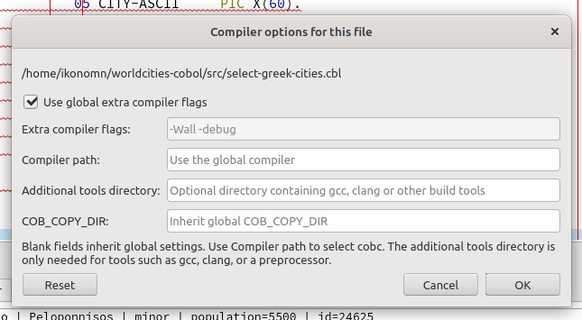

# modern11.5 compiler workflow

Open a saved source and choose **COBOL → Compiler options for this file…**.



The dialog can store custom extra flags, compiler path, and `COB_COPY_DIR` for
that source. Blank fields inherit the global values. Use **Compiler path** to
select a particular `cobc`. The optional **Additional tools directory** is
searched before the existing `PATH` and is intended for a particular `gcc`,
`clang`, or preprocessor. OpenCobolIDE never replaces the complete `PATH`.
Reset returns every field to the global defaults.

These settings apply to normal GnuCOBOL compilation and live syntax checking.
They do not alter the operating-system environment or the settings of another
open source.

GixSQL projects that provide an executable `build.sh` retain their existing
workflow. The script detects embedded SQL, preprocesses SQL sources with
`gixpp`, and compiles the generated COBOL with `cobc`. Sources without SQL use
the script's flat COBOL compilation path. The per-source dialog does not bypass
the project script.

For normal GnuCOBOL compilation, a source containing both `LINKAGE SECTION`
and `PROCEDURE DIVISION USING` is detected as a callable subprogram and is
compiled explicitly with `cobc -m`. Other sources remain executable builds
with `cobc -x`.

When a path contains outer whitespace or whitespace beside a directory
separator, OpenCobolIDE displays the original and cleaned values and stores the
cleaned path. For example, `/ ikonomn / dir1/ dir3/ ` becomes
`/ikonomn/dir1/dir3/`. A real directory name such as `My Projects` is retained.

## Source format directives

The editor automatically recognizes these directives, without requiring the
global **Free format** option to be changed:

```cobol
>>SOURCE FREE
>>SOURCE FORMAT IS FREE
>>SOURCE FIXED
>>SOURCE FORMAT IS FIXED
```

The first directive controls the editor layout, margins, highlighting,
navigation, and live syntax checking. The status-bar **Free format** option
shows the detected value and is locked while the source directive is active.
Files without a directive continue to use the global preference.

The source is passed unchanged to GnuCOBOL, which remains responsible for any
additional format switches later in the same file.

## Pending local bug-report work

See [Local bug-report fixes and investigation status](local-bug-report-status.md)
for unreleased runtime-diagnostics changes and the status of Vincent's scrolling
and tooltip reports. These entries do not imply fixes are included in a release.
